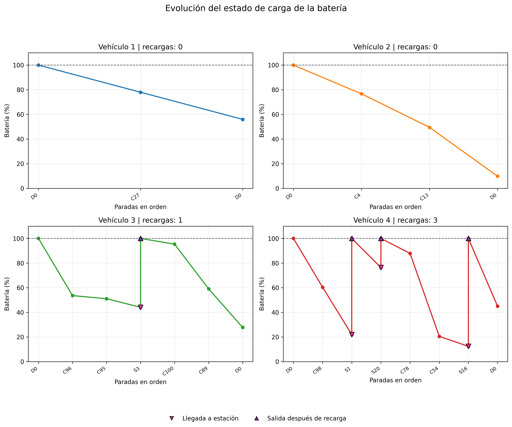
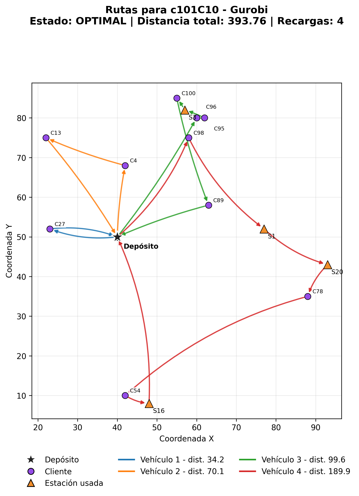
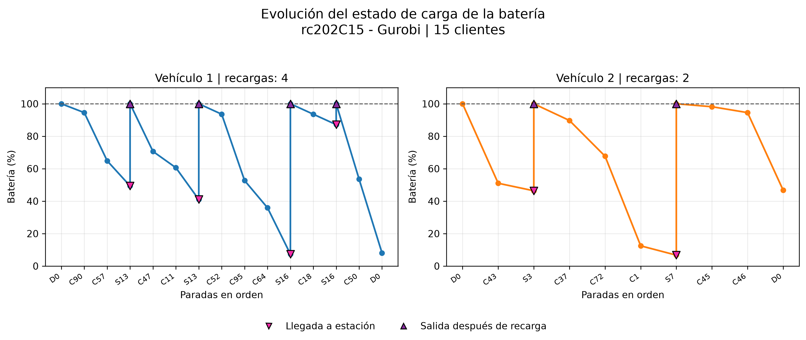
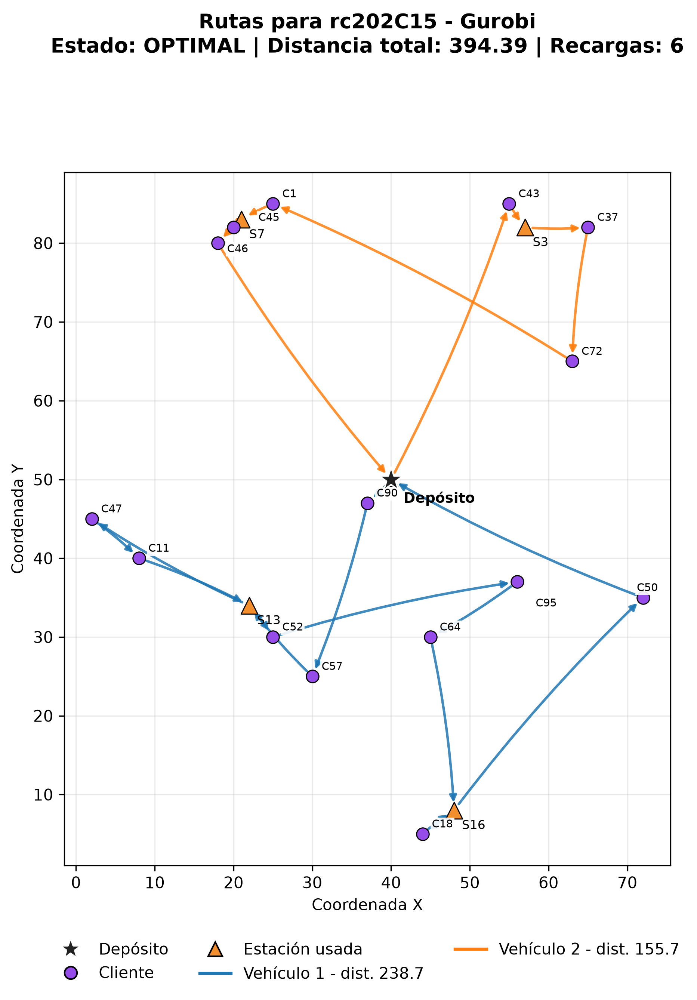
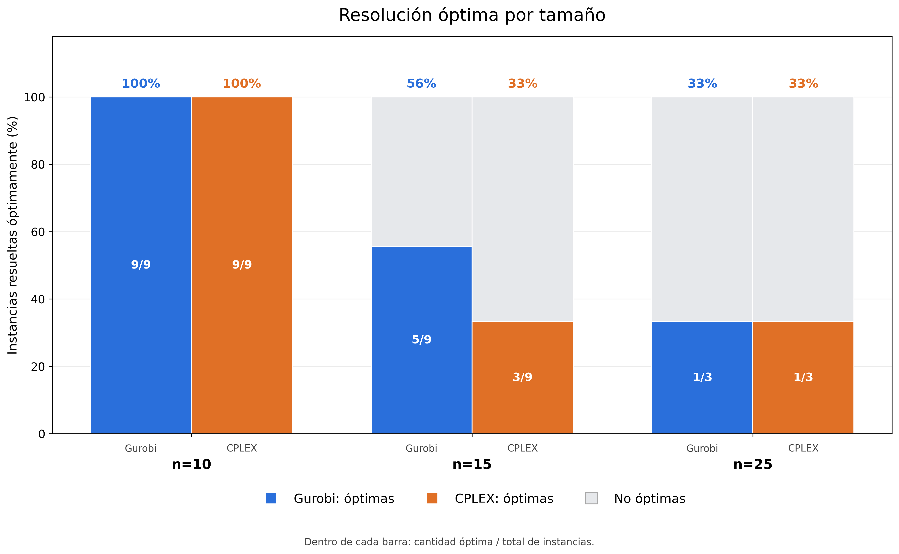
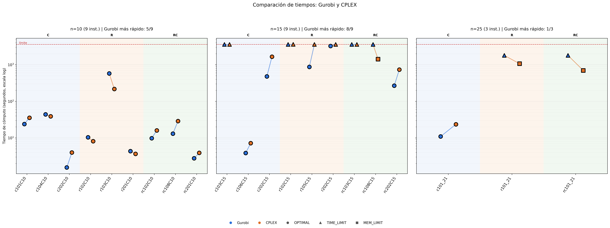
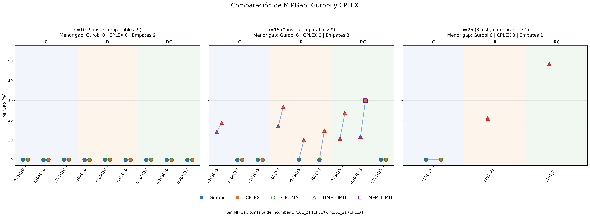
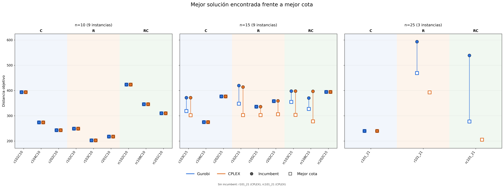

### Configuración del entorno de benchmarking
* **Infraestructura:** Servidor DIICC `chome.inf.udec.cl` (Python 3.12).
* **Solvers comparados:** **Gurobi 14** (licencia WLS, [`src/model_gurobi.py`](src/model_gurobi.py)) vs. **IBM CPLEX 22.2.0 Académico** vía DOcplex ([`src/model_cplex.py`](src/model_cplex.py)).
* **Parámetros comunes:** `threads = 8`, tolerancia objetivo `mip_gap = 0.0` , cotas $M^{(1)}_{ij}$ y $M^{(2)}_{rj}$ ajustadas por arco, ruptura de simetría lexicográfica en flota y poda previa de arcos ([`src/parser.py`](src/parser.py)).
* **Límites computacionales:**
  * **Tiempo:** `3600 s` (1 hora) en escalas `n=10` y `n=15`; `1800 s` (30 min) en la escala de estrés `n=25`, respetando en todas las corridas el límite máximo de 1 hora exigido por la rúbrica.
  * **Memoria:** `SoftMemLimit = 8.0 GB` en Gurobi; `mip.limits.treememory = 8192 MB` y `workmem = 2048 MB` en CPLEX.
* **Validación operativa independiente:** Todas las corridas que entregaron rutas factibles (**21/21 en Gurobi** y **19/21 en CPLEX**, total **40/40 soluciones con *incumbent***) fueron verificadas mediante simulación secuencial hacia adelante en [`src/validator.py`](src/validator.py) (`is_valid = True`), dando coincidencia exacta con la distancia objetivo reportada, cumplimiento de capacidad de carga, ventanas horarias y estado de carga (*SoC*) no negativo en todo el recorrido. Las únicas 2 corridas con `is_valid = False` corresponden a `r101_21` y `rc101_21` en CPLEX, donde el solver alcanzó `MEM_LIMIT` antes de hallar un *incumbent*.

---

## 1. Diseño y Diversidad de la Batería de Instancias

Las pruebas se diseñaron sobre el conjunto estándar de la literatura de **Schneider et al. (2014)** (DOI: `10.17632/h3mrm5dhxw.1`), almacenado en [`data/`](data/) y parametrizado de forma replicable en [`src/instances_battery.py`](src/instances_battery.py) y [`src/benchmark.py`](src/benchmark.py).

### 1.1 Cobertura de características (mínimo $\ge 3$ instancias por característica)
La batería abarca **21 instancias** (**42 corridas** entre Gurobi y CPLEX) estructuradas en torno a cuatro ejes de diversidad:

1. **Distribución espacial de clientes (7 instancias por familia):**
   * **Agrupadas (`C`):** clientes concentrados en clústeres geográficos (`c101C10`, `c104C10`, `c202C10`, `c103C15`, `c106C15`, `c202C15`, `c101_21`).
   * **Aleatorias (`R`):** clientes dispersos uniformemente en el plano (`r102C10`, `r103C10`, `r201C10`, `r102C15`, `r105C15`, `r202C15`, `r101_21`).
   * **Mixtas (`RC`):** combinación de clústeres y clientes dispersos (`rc102C10`, `rc108C10`, `rc201C10`, `rc103C15`, `rc108C15`, `rc202C15`, `rc101_21`).
2. **Escala de tamaño (3 niveles):**
   * `n=10` (9 instancias oficiales `C10`: 3 `C`, 3 `R`, 3 `RC`) con `station_copies = 2`.
   * `n=15` (9 instancias oficiales `C15`: 3 `C`, 3 `R`, 3 `RC`) con `station_copies = 2`.
   * `n=25` (3 instancias de estrés recortadas de `*_21.txt`: 1 `C`, 1 `R`, 1 `RC`) con `station_copies = 1` y `max_customers = 25`.
3. **Régimen temporal y capacidad — Series `1xx` vs. `2xx`:**
   * **Serie `1xx` (15 instancias: 12 en `n=10,15` + 3 en `n=25`):** horizontes cortos ($H \in [230, 1236]$), capacidad de carga ajustada ($C = 200$), mayor necesidad de flota ($K \in [4, 8]$) y ventanas horarias más restrictivas.
   * **Serie `2xx` (6 instancias en `n=10,15`):** horizontes largos ($H \in [960, 3390]$), alta capacidad de carga ($C \in \{700, 1000\}$) y menor flota ($K \in \{3, 4\}$).
4. **Parámetros energéticos diferenciados por familia:**
   * En todas las instancias $h = 1.0$ (consumo unitario por distancia) y $v = 1.0$ (velocidad unitaria).
   * Familia `C`: batería $Q_{\text{bat}} \in \{77.75, 79.69\}$ y tasa inversa de recarga lenta $g \in \{3.39, 3.47\}$.
   * Familia `R`: batería menor $Q_{\text{bat}} \in \{60.63, 62.14\}$ y recarga rápida $g \in \{0.48, 0.49\}$.
   * Familia `RC`: batería $Q_{\text{bat}} \in \{77.75, 79.69\}$ y recarga rápida $g \in \{0.38, 0.39\}$.

### 1.2 Dimensionalidad del modelo PLEM y efecto de la poda de arcos

La función `build_arcs` de [`src/parser.py`](src/parser.py) elimina arcos infactibles por batería ($h \cdot d_{ij} > Q_{\text{bat}}$), por ventana de tiempo ($e_i + s_i + t_{ij} > l_j$), saltos entre copias de la misma estación y recargas redundantes en coordenadas del depósito. La siguiente tabla resume las propiedades estructurales y el tamaño exacto de cada instancia:

| Instancia  | Fam. | Escala | $n$ | Est. ($S \times \text{cop.} = \lvert V_R \rvert$) | $K$ | $Q_{\text{bat}}$ | $C$  | $g$  | Horizonte $H$ | Ancho TW prom. (% $H$) | Demanda total | Arcos válidos / posibles (% poda) | Vars. binarias ($x_{ijk}$) |
| :---       | :---:| :---:  | :---:| :---:                                              | :---:| :---:            | :---:| :---:| :---:         | :---:                  | :---:         | :---:                             | :---:                      |
| `c101C10`  | C    | `n=10` | 10  | $5 \times 2 = 10$                                  | 4   | 77.75            | 200  | 3.47 | 1236.0        | 60.8 (4.9%)            | 200.0         | 351 / 420 (16.4%)                 | 1,404                      |
| `c104C10`  | C    | `n=10` | 10  | $4 \times 2 = 8$                                   | 4   | 77.75            | 200  | 3.47 | 1236.0        | 1013.5 (82.0%)         | 180.0         | 328 / 342 (4.1%)                  | 1,312                      |
| `c202C10`  | C    | `n=10` | 10  | $5 \times 2 = 10$                                  | 3   | 77.75            | 700  | 3.47 | 3390.0        | 470.4 (13.9%)          | 220.0         | 371 / 420 (11.7%)                 | 1,113                      |
| `r102C10`  | R    | `n=10` | 10  | $4 \times 2 = 8$                                   | 4   | 60.63            | 200  | 0.49 | 230.0         | 64.8 (28.2%)           | 155.0         | 271 / 342 (20.8%)                 | 1,084                      |
| `r103C10`  | R    | `n=10` | 10  | $3 \times 2 = 6$                                   | 4   | 60.63            | 200  | 0.49 | 230.0         | 124.7 (54.2%)          | 139.0         | 252 / 272 (7.4%)                  | 1,008                      |
| `r201C10`  | R    | `n=10` | 10  | $4 \times 2 = 8$                                   | 3   | 60.63            | 1000 | 0.49 | 1000.0        | 123.6 (12.4%)          | 181.0         | 296 / 342 (13.5%)                 | 888                        |
| `rc102C10` | RC   | `n=10` | 10  | $4 \times 2 = 8$                                   | 5   | 77.75            | 200  | 0.39 | 240.0         | 48.0 (20.0%)           | 181.0         | 282 / 342 (17.5%)                 | 1,410                      |
| `rc108C10` | RC   | `n=10` | 10  | $4 \times 2 = 8$                                   | 4   | 77.75            | 200  | 0.39 | 240.0         | 115.6 (48.2%)          | 146.0         | 305 / 342 (10.8%)                 | 1,220                      |
| `rc201C10` | RC   | `n=10` | 10  | $4 \times 2 = 8$                                   | 3   | 77.75            | 1000 | 0.39 | 960.0         | 120.0 (12.5%)          | 160.0         | 289 / 342 (15.5%)                 | 867                        |
| `c103C15`  | C    | `n=15` | 15  | $5 \times 2 = 10$                                  | 5   | 77.75            | 200  | 3.47 | 1236.0        | 557.3 (45.1%)          | 260.0         | 592 / 650 (8.9%)                  | 2,960                      |
| `c106C15`  | C    | `n=15` | 15  | $3 \times 2 = 6$                                   | 5   | 77.75            | 200  | 3.47 | 1236.0        | 192.4 (15.6%)          | 170.0         | 358 / 462 (22.5%)                 | 1,790                      |
| `c202C15`  | C    | `n=15` | 15  | $5 \times 2 = 10$                                  | 4   | 77.75            | 700  | 3.47 | 3390.0        | 1194.7 (35.2%)         | 240.0         | 577 / 650 (11.2%)                 | 2,308                      |
| `r102C15`  | R    | `n=15` | 15  | $8 \times 2 = 16$                                  | 6   | 60.63            | 200  | 0.49 | 230.0         | 34.9 (15.2%)           | 191.0         | 833 / 992 (16.0%)                 | 4,998                      |
| `r105C15`  | R    | `n=15` | 15  | $6 \times 2 = 12$                                  | 6   | 60.63            | 200  | 0.49 | 230.0         | 30.0 (13.0%)           | 211.0         | 619 / 756 (18.1%)                 | 3,714                      |
| `r202C15`  | R    | `n=15` | 15  | $6 \times 2 = 12$                                  | 4   | 60.63            | 1000 | 0.49 | 1000.0        | 415.7 (41.6%)          | 261.0         | 662 / 756 (12.4%)                 | 2,648                      |
| `rc103C15` | RC   | `n=15` | 15  | $5 \times 2 = 10$                                  | 6   | 77.75            | 200  | 0.39 | 240.0         | 108.4 (45.2%)          | 204.0         | 570 / 650 (12.3%)                 | 3,420                      |
| `rc108C15` | RC   | `n=15` | 15  | $5 \times 2 = 10$                                  | 5   | 77.75            | 200  | 0.39 | 240.0         | 119.3 (49.7%)          | 277.0         | 593 / 650 (8.8%)                  | 2,965                      |
| `rc202C15` | RC   | `n=15` | 15  | $5 \times 2 = 10$                                  | 4   | 77.75            | 1000 | 0.39 | 960.0         | 225.0 (23.4%)          | 233.0         | 527 / 650 (18.9%)                 | 2,108                      |
| `c101_21`  | C    | `n=25` | 25  | $21 \times 1 = 21$                                 | 6   | 79.69            | 200  | 3.39 | 1236.0        | 63.2 (5.1%)            | 460.0         | 1792 / 2162 (17.1%)               | 10,752                     |
| `r101_21`  | R    | `n=25` | 25  | $21 \times 1 = 21$                                 | 8   | 62.14            | 200  | 0.48 | 230.0         | 10.0 (4.3%)            | 332.0         | 1591 / 2162 (26.4%)               | 12,728                     |
| `rc101_21` | RC   | `n=25` | 25  | $21 \times 1 = 21$                                 | 7   | 79.69            | 200  | 0.38 | 240.0         | 30.0 (12.5%)           | 540.0         | 1622 / 2162 (25.0%)               | 11,354                     |

Al recortar los primeros 25 clientes (`max_customers=25`), los archivos `*_21.txt` muestran comportamientos geométricos muy distintos según cómo fueron ordenados originalmente:
* En `c101_21`, los clientes están ordenados por clúster, por lo que los primeros 25 nodos quedan concentrados en un cuadrante compacto cercano al depósito $(40,50)$ ($x \in [15, 45],\, y \in [50, 85]$). Con $Q_{\text{bat}} = 79.69$, 4 vehículos resuelven toda la demanda con solo **1 recarga** total y distancia `240.01`.
* En `r101_21` ($x \in [5, 65],\, y \in [5, 65]$, $Q_{\text{bat}} = 62.14$) y `rc101_21` ($x \in [0, 44],\, y \in [5, 85]$), los primeros 25 clientes mantienen alta dispersión y exigen **6 y 5 recargas** respectivamente (8 y 6 vehículos activos en Gurobi), disparando la complejidad combinatoria por encima de `11,300` variables binarias.

---

## 2. Evaluación Crítica de Supuestos y Limitaciones

### 2.1 Recarga completa obligatoria hasta $Q_{\text{bat}}$

El modelo impone que todo vehículo que visita una estación $r \in V_R$ debe permanecer cargando un tiempo $\Delta t_r = g(Q_{\text{bat}} - Y_{rk})$ hasta alcanzar exactamente el 100% de su batería (restricciones 7 y 9).

* **Evidencia empírica en nuestros resultados:**
  * En las **55 rutas** que realizan al menos una recarga, los vehículos regresan al depósito final con una **media de 32.0% de SoC remanente** (mediana **29.0%**, máximo **76.0%**). Esta energía cargada en ruta nunca se necesita para completar el retorno.
  * El impacto temporal es crítico en la familia `C`, donde la tasa de recarga es lenta ($g = 3.47$, entre 7 y 9 veces mayor que en `R` y `RC`). En la familia `C`, el tiempo de recarga consume en promedio el **13.8%** de la duración total de la ruta (hasta **43.1%** en una ruta individual y **32.7%** agregado en `c104C10`).
  * Casos extremos de tiempo desperdiciado recargando energía sobrante al retorno: en `c202C15` (Vehículo 0), retorna con **66.7%** de SoC tras haber invertido **179.9 u.t.** ($15.1\%$ del tiempo total de ruta) en carga innecesaria; en `c103C15` (Vehículo 2), retorna con **64.9%** (**175.1 u.t.**, $15.5\%$); y en `c104C10` (Vehículo 1), retorna con **51.1%** (**137.7 u.t.**, **23.9%** de la duración total de su ruta).
  * Asimismo, la rigidez de ventanas y autonomía produce artefactos como saltos directos estación-estación (`S1 -> S20` llegando con **76.4%** de SoC en `c101C10` Vehículo 4; `S5 -> S3` llegando con **66.5%** en `rc108C10` Vehículo 2) y recargas marginales como en `rc202C15` (Vehículo 1), donde el vehículo visita `S16 -> C18 -> S16` llegando al segundo paso por `S16` con **87.1%** de SoC.

| Perfil de batería SoC en `c101C10` | Mapa de rutas en `c101C10` |
| :---: | :---: |
|  |  |

| Perfil de batería SoC en `rc202C15` | Mapa de rutas en `rc202C15` |
| :---: | :---: |
|  |  |

* **Impacto en la validez del modelo:**
  1. **Subestimación de la capacidad temporal de servicio:** al prohibir recargas parciales ajustadas a la energía faltante hasta el próximo punto o depósito, el modelo declara infactibles rutas que sí serían viables con recarga parcial, o fuerza el despacho de vehículos adicionales (Desaulniers et al., 2016; Keskin & Çatay, 2016).
  2. **Irrealismo electroquímico:** la curva real de carga en baterías de ion-litio sigue un perfil CC-CV (*Constant Current - Constant Voltage*): cargar del 80% al 100% toma proporcionalmente mucho más tiempo que del 20% al 80% y acelera la degradación de celdas. La recarga lineal completa hasta el 100% subestima el costo temporal de saturar la batería (Montoya et al., 2017).

### 2.2 Tasa de consumo energético lineal e independiente de la carga ($h \cdot d_{ij}$)

El modelo asume que el consumo depende exclusivamente de la distancia euclidiana ($h \cdot d_{ij}$ con $h = 1.0$), ignorando la masa transportada, la pendiente topográfica, el tráfico y los consumos auxiliares (climatización/refrigeración).

* **Evidencia empírica en nuestros resultados:**
  * En la serie `1xx`, la utilización promedio de la capacidad de carga física es **29.9%**, alcanzando hasta el **100.0%** de $C_{\text{cap}} = 200$ (en la serie `2xx` es **9.9%** promedio, máx. **18.6%**). Un camión circulando al 100% de carga posee mayor resistencia a la rodadura y mayor energía cinética en frenadas/aceleraciones que un camión casi vacío al final de su ruta.
  * El modelo exprime la batería hasta el límite matemático (0% permitido en restricción 10): de las 76 rutas de Gurobi, **11 rutas (14.5%)** caen bajo **5% de SoC**, **26 rutas (34.2%)** bajo **10% de SoC** y **40 rutas (52.6%)** bajo **15% de SoC**.
  * Se observan arribos críticos a estación con **0.10%** (`c202C10` V1 en `S15`), **2.90%** (`rc108C10` V1 en `S19`), **3.05%** (`r105C15` V3 en `S13`) y **3.29%** (`c202C15` V0 en `S15`), además de retornos al depósito con **0.67%** (`rc102C10` V0), **1.44%** (`c103C15` V1) y **1.70%** (`r102C10` V1).
* **Impacto en la validez del modelo:**
  * Más de un tercio de las rutas óptimas calculadas opera sin margen de seguridad (*buffer* de SoC). Según Goeke & Schneider (2015), incorporar consumo dependiente de carga, velocidad y pendiente puede alterar significativamente la secuencia de visitas (favoreciendo atender primero a clientes de alta demanda cerca del depósito o estaciones) y volver infactibles las rutas con SoC mínimo $< 10\%$.

### 2.3 Velocidad constante ($v = 1.0$) y distancia euclidiana ($d_{ij}$)

* **Análisis crítico:** El modelo calcula $t_{ij} = d_{ij} / v$ en línea recta con velocidad constante. En redes urbanas reales existen factores de circuidad vial ($\approx 1.2\text{–}1.4\times$), intersecciones, semáforos y congestión dependiente de la hora del día. Además, el consumo aerodinámico crece cuadráticamente con la velocidad ($\propto v^2$).
* **Impacto en la validez del modelo:** Las instancias más exigentes poseen ventanas muy estrechas en proporción al horizonte: `r101_21` tiene un ancho promedio de apenas **10.0 u.t. (4.3% del horizonte)**, `c101C10` **60.8 u.t. (4.9%)** y `c101_21` **63.2 u.t. (5.1%)**. Cualquier desvío vial o congestión convierte una ruta aparentemente óptima en una violación de ventana horaria.

### 2.4 Ausencia de colas en estaciones y copias finitas (`station_copies`)

El modelo duplica cada estación física en copias ficticias ($V_R$) de uso unitario (restricción 2), pero **no acopla temporalmente las copias entre sí** ni limita el número de cargadores simultáneos.

* **Evidencia empírica en nuestros resultados:**
  * En las 21 soluciones de Gurobi y 19 de CPLEX se verificó la reutilización efectiva de estaciones físicas en **4 casos por solver**: en Gurobi, `r102C15` (`S7` usada dos veces por V0), `r202C15` (`S13` usada por V1 en `[19.1, 28.5]` y por V0 en `[502.7, 516.2]`), `rc202C15` (`S13` y `S16` usadas dos veces por V0); en CPLEX, `r102C15` (`S7` y `S9`) y `rc202C15` (`S13` y `S16`).
  * Aunque en estas escalas ($n \le 25$) hubo **0 solapamientos temporales** simultáneos en una misma estación física, el riesgo crece cuadráticamente al aumentar el tamaño de flota o concentrar ventanas en horas punta.
  * **Limitación de truncamiento (`station_copies=1` en `n=25`):** por tratabilidad computacional se redujo `station_copies` de `2` a `1` en `n=25`, lo cual prohíbe visitar una misma estación física más de una vez en toda la flota. Como demuestra `r102C15` y `rc202C15`, donde revisitar una misma estación fue parte de la solución óptima, esta restricción artificial recorta el espacio factible real en `n=25`.

### 2.5 Limitaciones estructurales adicionales de la implementación PLEM

1. **Función objetivo mono-criterio (solo distancia):** a diferencia de Schneider et al. (2014), donde primero se minimiza el número de vehículos y luego la distancia total, el modelo implementado minimiza únicamente $\sum d_{ij} x_{ijk}$ (el término de costo fijo $W$ quedó solo anotado como opcional en [`modelo_matematico.md`](modelo_matematico.md)). Además, no penaliza los tiempos de espera en nodos: los tiempos de espera representan en promedio el **29.8%** de la duración de ruta en la serie `1xx` y el **66.3%** (mediana **70.6%**) en la serie `2xx`.
2. **Determinismo y flota homogénea:** demandas, tiempos de viaje y tasas de carga son deterministas, y todos los vehículos comparten idéntica capacidad física y de batería.
3. **Debilidad de la relajación lineal por cotas Big-M:** aunque se calculan cotas ajustadas $M^{(1)}_{ij}$ y $M^{(2)}_{rj}$, la cota $M^{(2)}_{rj} = \max\{0, l_r + g \cdot Q_{\text{bat}} + t_{rj} - e_j\}$ acopla el peor caso de recarga completa, dejando una relajación LP débil cuando las ventanas son amplias (`c104C10`: $82.0\%$ del horizonte; `r103C10`: $54.2\%$) o cuando $K$ crece.

| Supuesto / Limitación | Evidencia empírica en el estudio | Impacto en la validez operativa | Extensión recomendada en literatura |
| :--- | :--- | :--- | :--- |
| **Recarga completa ($Q_{\text{bat}}$)** | Retorno con 32.0% SoC prom.; hasta 23.9% del tiempo de ruta en energía sobrante (`c104C10`) y saltos `S1->S20` (`76.4%` SoC) | Infla tiempos de ruta, puede causar infactibilidad artificial o sobredimensionar flota | Recarga parcial continua y funciones lineales por tramos CC-CV (Desaulniers et al., 2016; Montoya et al., 2017) |
| **Consumo lineal ($h \cdot d_{ij}$)** | 34.2% de rutas cae $<10\%$ SoC; 14.5% cae $<5\%$ (mín. 0.10%); carga física llega a 100% de $C$ | Alto riesgo de agotar batería en ruta ante carga pesada, pendiente o tráfico | Consumo dependiente de masa, velocidad y pendiente (Goeke & Schneider, 2015) + *buffer* mínimo de SoC (15–20%) |
| **Velocidad constante y distancia euclidiana** | Ventanas de hasta solo 4.3% del horizonte (`r101_21`, ancho 10.0 u.t.) | Subestima tiempos y distancias reales; quiebre de ventanas por congestión | Matriz de distancias/tiempos reales dependientes de franja horaria (TD-EVRPTW) |
| **Sin colas ni capacidad en estaciones** | 4 estaciones físicas reutilizadas por solver (`r102C15`, `r202C15`, `rc202C15`); 0 solapamientos en $n \le 25$ | Riesgo de esperas no modeladas y efecto dominó en ventanas al escalar la flota | Restricciones de capacidad/programación en cargadores (Froger et al., 2022) |
| **`station_copies = 1` en `n=25`** | En `n=15` fue óptimo revisitar `S7`, `S9`, `S13`, `S16` | Elimina soluciones válidas que requieren múltiples visitas a una estación estratégica | Generación dinámica de copias o modelado basado en arcos de recarga (*FRV*) |
| **Objetivo solo distancia y cotas Big-M** | Esperas de 66.3% del tiempo en `2xx`; gaps de hasta 48.5% y `MEM_LIMIT` en $n=25$ | No optimiza tamaño de flota ni tiempo ocioso; relajación LP débil bloquea escalabilidad | Objetivo jerárquico $(\lvert K \rvert, \text{distancia})$ + formulación de 2 índices o *Branch-and-Price* |

---

## 3. Comparación Computacional Gurobi vs. CPLEX y Análisis de Escalabilidad

### 3.1 Tabla maestra de resultados (21 instancias, 42 corridas)

La tabla siguiente reporta las tres métricas exigidas (**Tiempo de cómputo [s]**, **MIPGap [%]** y **Best objective / incumbent**), junto con cota dual (`Best Bound`), nodos explorados, vehículos/recargas y diferencia de cota dual ($\Delta \text{Bound} = \text{Bound}_{\text{Gurobi}} - \text{Bound}_{\text{CPLEX}}$), extraídos directamente de [`results/comparacion_solvers.csv`](results/comparacion_solvers.csv):

| Instancia | Fam. | Escala | Gurobi Estado | Gurobi Obj. | Gurobi Bound | Gurobi Gap (%) | Gurobi Tiempo (s) | Gurobi Nodos | Gurobi V/R | CPLEX Estado | CPLEX Obj. | CPLEX Bound | CPLEX Gap (%) | CPLEX Tiempo (s) | CPLEX Nodos | CPLEX V/R | $\Delta$ Bound (G-C) |
| :--- | :---: | :---: | :--- | :---: | :---: | :---: | :---: | :---: | :---: | :--- | :---: | :---: | :---: | :---: | :---: | :---: | :---: |
| `c101C10` | C | `n=10` | OPTIMAL | 393.7633 | 393.7633 | 0.0000 | 23.9341 | 40,244 | 4 / 4 | OPTIMAL | 393.7633 | 393.7633 | 0.0000 | 35.5102 | 95,789 | 4 / 4 | 0.0000 |
| `c104C10` | C | `n=10` | OPTIMAL | 273.9312 | 273.9312 | 0.0000 | 43.8611 | 50,768 | 2 / 3 | OPTIMAL | 273.9312 | 273.9312 | 0.0000 | 38.7564 | 91,989 | 2 / 3 | 0.0000 |
| `c202C10` | C | `n=10` | OPTIMAL | 243.2035 | 243.2035 | 0.0000 | 1.5542 | 1,648 | 2 / 2 | OPTIMAL | 243.2035 | 243.2035 | 0.0000 | 3.9734 | 9,739 | 2 / 2 | 0.0000 |
| `r102C10` | R | `n=10` | OPTIMAL | 249.1893 | 249.1893 | 0.0000 | 10.3718 | 48,456 | 3 / 3 | OPTIMAL | 249.1893 | 249.1893 | 0.0000 | 8.1097 | 29,691 | 3 / 3 | 0.0000 |
| `r103C10` | R | `n=10` | OPTIMAL | 202.8527 | 202.8527 | 0.0000 | 578.7434 | 1,326,880 | 3 / 2 | OPTIMAL | 202.8527 | 202.8527 | 0.0000 | 216.8944 | 396,976 | 3 / 2 | 0.0000 |
| `r201C10` | R | `n=10` | OPTIMAL | 217.6754 | 217.6754 | 0.0000 | 4.3423 | 3,919 | 3 / 2 | OPTIMAL | 217.6754 | 217.6754 | 0.0000 | 3.6667 | 7,594 | 3 / 2 | 0.0000 |
| `rc102C10` | RC | `n=10` | OPTIMAL | 423.5102 | 423.5102 | 0.0000 | 9.7589 | 17,240 | 4 / 3 | OPTIMAL | 423.5102 | 423.5102 | 0.0000 | 16.0181 | 39,855 | 4 / 3 | 0.0000 |
| `rc108C10` | RC | `n=10` | OPTIMAL | 345.9273 | 345.9273 | 0.0000 | 13.0823 | 30,655 | 3 / 3 | OPTIMAL | 345.9273 | 345.9273 | 0.0000 | 28.7790 | 57,781 | 3 / 3 | 0.0000 |
| `rc201C10` | RC | `n=10` | OPTIMAL | 310.0573 | 310.0573 | 0.0000 | 2.7627 | 8,884 | 3 / 3 | OPTIMAL | 310.0573 | 310.0573 | 0.0000 | 3.9041 | 14,659 | 3 / 3 | 0.0000 |
| `c103C15` | C | `n=15` | TIME_LIMIT | 371.7000 | 319.0256 | 14.1712 | 3600.0089 | 1,387,722 | 4 / 3 | TIME_LIMIT | 371.7002 | 302.1104 | 18.7220 | 3604.5136 | 2,639,428 | 4 / 3 | **+16.9152** |
| `c106C15` | C | `n=15` | OPTIMAL | 275.1332 | 275.1332 | 0.0000 | 3.8562 | 4,464 | 3 / 2 | OPTIMAL | 275.1332 | 275.1332 | 0.0000 | 7.1729 | 6,995 | 3 / 2 | 0.0000 |
| `c202C15` | C | `n=15` | OPTIMAL | 376.7893 | 376.7893 | 0.0000 | 479.4083 | 434,967 | 3 / 4 | OPTIMAL | 376.7893 | 376.7893 | 0.0000 | 1653.2155 | 1,241,607 | 3 / 4 | 0.0000 |
| `r102C15` | R | `n=15` | TIME_LIMIT | 419.6420 | 348.1620 | 17.0336 | 3600.0286 | 1,269,744 | 6 / 5 | TIME_LIMIT | **413.9341** | 302.8295 | 26.8412 | 3606.9921 | 1,443,295 | 5 / 6 | **+45.3325** |
| `r105C15` | R | `n=15` | OPTIMAL | 336.1536 | 336.1536 | 0.0000 | 873.1210 | 385,828 | 4 / 4 | TIME_LIMIT | 336.1536 | 302.8080 | 9.9197 | 3604.6588 | 3,092,166 | 4 / 4 | **+33.3456** |
| `r202C15` | R | `n=15` | OPTIMAL | 358.0048 | 358.0048 | 0.0000 | 3247.1119 | 1,850,405 | 2 / 6 | TIME_LIMIT | 359.0802 | 306.1593 | 14.7379 | 3601.5485 | 2,973,489 | 3 / 5 | **+51.8455** |
| `rc103C15` | RC | `n=15` | TIME_LIMIT | 397.6699 | 355.0867 | 10.7082 | 3600.0702 | 2,056,003 | 4 / 4 | TIME_LIMIT | 397.6699 | 303.5934 | 23.6569 | 3605.0804 | 3,860,333 | 4 / 4 | **+51.4933** |
| `rc108C15` | RC | `n=15` | TIME_LIMIT | 370.2463 | 327.1920 | 11.6286 | 3600.0298 | 2,502,930 | 3 / 4 | MEM_LIMIT | 396.9885 | 278.1007 | 29.9474 | 1421.2518 | 1,573,638 | 4 / 3 | **+49.0913** |
| `rc202C15` | RC | `n=15` | OPTIMAL | 394.3871 | 394.3871 | 0.0000 | 266.9526 | 180,144 | 2 / 6 | OPTIMAL | 394.3871 | 394.3871 | 0.0000 | 735.3118 | 1,109,250 | 2 / 6 | 0.0000 |
| `c101_21` | C | `n=25` | OPTIMAL | 240.0079 | 240.0079 | 0.0000 | 10.9315 | 2,499 | 4 / 1 | OPTIMAL | 240.0079 | 240.0079 | 0.0000 | 23.5543 | 7,576 | 4 / 1 | 0.0000 |
| `r101_21` | R | `n=25` | TIME_LIMIT | 593.2916 | 469.1390 | 20.9261 | 1800.0664 | 61,897 | 8 / 6 | MEM_LIMIT | *Sin inc.* | 392.7045 | — | 1069.0816 | 0 | 0 / 0 | **+76.4345** |
| `rc101_21` | RC | `n=25` | TIME_LIMIT | 538.9301 | 277.3764 | 48.5320 | 1800.0403 | 44,128 | 6 / 5 | MEM_LIMIT | *Sin inc.* | 205.6278 | — | 698.4874 | 0 | 0 / 0 | **+71.7486** |

*(Nota: V/R indica vehículos utilizados / recargas totales en ruta).*

### 3.2 Desempeño agregado por escala, familia y serie

| Resumen de óptimos por escala | Comparación de tiempos (escala logarítmica) |
| :---: | :---: |
|  |  |

#### Comparación agregada por escala
| Escala | Inst. | Gurobi OPT / TL / ML | Gurobi Tiempo prom. / med. (s) | Gurobi Gap prom. (%) | CPLEX OPT / TL / ML | CPLEX Tiempo prom. / med. (s) | CPLEX Gap prom. (%) |
| :--- | :---: | :---: | :---: | :---: | :---: | :---: | :---: |
| `n=10` | 9 | 9 / 0 / 0 | 76.49 / 10.37 | 0.00% | 9 / 0 / 0 | 39.51 / 16.02 | 0.00% |
| `n=15` | 9 | 5 / 4 / 0 | 2141.18 / 3247.11 | 5.95% | 3 / 5 / 1 | 2426.64 / 3601.55 | 13.76% |
| `n=25` | 3 | 1 / 2 / 0 | 1203.68 / 1800.04 | 23.15% | 1 / 0 / 2 | 597.04 / 698.49 | 0.00% *(1/3 con inc.)* |

#### Comparación agregada por familia espacial y por serie temporal
| Agrupación | Inst. | Gurobi OPT (ML) | Gurobi Tiempo prom. / med. (s) | Gurobi Gap prom. (%) | CPLEX OPT (ML) | CPLEX Tiempo prom. / med. (s) | CPLEX Gap prom. (%) |
| :--- | :---: | :---: | :---: | :---: | :---: | :---: | :---: |
| Familia `C` (todas) | 7 | 6 / 7 (0) | 594.79 / 23.93 | 2.02% | 6 / 7 (0) | 766.67 / 35.51 | 2.67% |
| Familia `R` (todas) | 7 | 5 / 7 (0) | 1444.83 / 873.12 | 5.42% | 3 / 7 (1) | 1730.14 / 1069.08 | 8.58% *(6 con inc.)* |
| Familia `RC` (todas) | 7 | 4 / 7 (0) | 1327.53 / 266.95 | 10.12% | 4 / 7 (2) | 929.83 / 698.49 | 8.93% *(6 con inc.)* |
| Serie `1xx` (`n=10,15`) | 12 | 8 / 12 (0) | med. 311.30 | 4.46% | 7 / 12 (1) | med. 127.83 | 9.09% |
| Serie `2xx` (`n=10,15`) | 6 | 6 / 6 (0) | med. 135.65 | 0.00% | 5 / 6 (0) | med. 369.64 | 2.46% |

**Patrones observados:**
* **En `n=10`, paridad con comportamiento opuesto entre media y mediana:** ambos solvers cierran el **100% (9/9)** de los óptimos con idéntica función objetivo. Gurobi gana en **5/9** instancias y tiene menor mediana (`10.37 s` vs. `16.02 s`), pero CPLEX logra menor tiempo promedio (`39.51 s` vs. `76.49 s`) porque en el caso atípico `r103C10` resuelve en `216.89 s` frente a `578.74 s` de Gurobi.
* **En `n=15`, despegue claro de Gurobi:** Gurobi cierra **5/9 (56%)** óptimos frente a **3/9 (33%)** de CPLEX, es más rápido en **8/9** instancias, reduce el *MIPGap* promedio a menos de la mitad (`5.95%` vs. `13.76%`) y nunca agota la memoria.
* **Por geometría y serie:** la familia `C` (agrupada) resulta la más favorable (6/7 óptimos en ambos), mientras `R` y `RC` elevan la dificultad por dispersión de distancias y múltiples rutas entrelazadas. Contrastando las series en `n=10` y `n=15`, la serie `2xx` es significativamente más tratable en cierre de optimalidad (Gurobi **6/6**, gap `0.00%`; CPLEX **5/6**, gap `2.46%`) que la serie `1xx` (Gurobi **8/12**, gap `4.46%`; CPLEX **7/12**, gap `9.09%`), porque su flota disponible $K \in \{3,4\}$ genera menos variables binarias (`867–2,648`) y menor simetría combinatoria que $K \in \{4..6\}$ (`1,008–4,998`).

### 3.3 Cierre de brecha (*MIPGap*) y calidad de cotas duales

| Comparación de MIPGap (%) | Mejor solución (Incumbent) vs. Mejor cota dual |
| :---: | :---: |
|  |  |

El gráfico *Incumbent vs. Mejor cota* revela la causa raíz de la superioridad de Gurobi al escalar el problema:

1. **Superioridad sistemática de la cota dual en Gurobi:** en las **6 instancias de `n=15`** donde al menos un solver no cerró el óptimo, Gurobi obtuvo una cota inferior estrictamente mejor que CPLEX por márgenes entre **+16.92** (`c103C15`) y **+51.85** unidades (`r202C15`), pasando por `+33.35` (`r105C15`), `+45.33` (`r102C15`), `+49.09` (`rc108C15`) y `+51.49` (`rc103C15`). En `n=25`, la ventaja dual crece a **+76.43** (`r101_21`) y **+71.75** (`rc101_21`).
2. **El caso revelador de `r102C15` (cota dual vs. heurística primal):** `r102C15` es la única instancia no resuelta al óptimo donde **CPLEX encontró un mejor *incumbent*** (`413.9341` con 5 vehículos y 6 recargas frente a `419.6420` con 6 vehículos y 5 recargas de Gurobi). Aun así, **Gurobi cerró un menor *MIPGap* (`17.03%` vs. `26.84%`)** porque su cota dual (`348.16`) superó ampliamente a la de CPLEX (`302.83`). Esto demuestra que la ventaja de Gurobi radica principalmente en el **fortalecimiento dual** (generación agresiva de planos de corte y ajuste de Big-M durante el *presolve* y en el árbol), más que solo en sus heurísticas primales.
3. **Caso atípico `r103C10`:** con ventanas anchas (`54.2%` del horizonte) y baja poda de arcos (`7.4%`), la degeneración combinatoria hizo que Gurobi explorara `1,326,880` nodos (`578.74 s`), mientras CPLEX aplicó una ramificación más selectiva (`396,976` nodos en `216.89 s`).

### 3.4 Paradoja velocidad de nodos vs. eficiencia del Branch-and-Cut

| Escala | Gurobi nodos totales | Gurobi vel. mediana / media (nodos/s) | CPLEX nodos totales | CPLEX vel. mediana / media (nodos/s) |
| :--- | :---: | :---: | :---: | :---: |
| `n=10` (9 inst.) | 1,528,694 | 1,766.6 / 2,121.3 | 744,073 | 2,451.0 / 2,592.8 |
| `n=15` (9 inst.) | 10,072,207 | 571.1 / 639.6 | 17,940,201 | 857.8 / 914.3 |
| `n=25` (3 inst.) | 108,524 | 34.4 / 95.8 | 7,576 *(1 inst. > 0)* | 321.6 / 321.6 *(en `c101_21`)* |

Se evidencia una **paradoja clara entre velocidad bruta por nodo y eficiencia global del árbol**:
* En `n=15`, CPLEX explora aproximadamente **1.5× más nodos por segundo** (mediana `857.8` vs. `571.1` nodos/s; casi **18 millones** de nodos acumulados frente a **10 millones** en Gurobi).
* Sin embargo, esa mayor velocidad por nodo no se traduce en cierre de brecha porque las cotas duales en los subproblemas de CPLEX progresan lentamente:
  * En `c202C15`, Gurobi prueba optimalidad en `434,967` nodos (`479.4 s`) vs. `1,241,607` nodos (`1653.2 s`) de CPLEX (~2.9× menos nodos).
  * En `rc202C15`, Gurobi requiere `180,144` nodos (`267.0 s`) vs. `1,109,250` nodos (`735.3 s`) de CPLEX (~6.2× menos nodos).
  * En `r105C15`, Gurobi cierra el óptimo en `385,828` nodos (`873.1 s`), mientras CPLEX explora `3,092,166` nodos (8× más nodos en 3604.7 s) y aún queda a `9.92%` de gap.
* **Explicación técnica:** Gurobi invierte más tiempo de CPU en cada nodo para resolver relajaciones fortalecidas con cortes (MIP cuts, MIR, flujo, cobertura) y propagación de cotas temporales/energéticas, logrando podar ramas temprano y contener la explosión del árbol de búsqueda.

### 3.5 Punto de quiebre, límites de memoria y aclaraciones metodológicas

* **Identificación del punto de quiebre:**
  * Hasta **`n = 10`** (867–1,410 variables binarias), el modelo PLEM de 3 índices es completamente tratable en menos de 1 minuto (salvo `r103C10`).
  * El **punto de quiebre** ocurre en **`n = 15`** (1,790–4,998 variables binarias): cuando $n=15$ se combina con ventanas intermedias/amplias o flota $K \ge 5$ (`c103C15`, `r102C15`, `rc103C15`, `rc108C15`), ambos solvers superan 1 hora de cómputo sin cerrar optimalidad.
  * En **`n = 25`** (10,752–12,728 variables binarias), el modelo exacto colapsa computacionalmente para instancias dispersas o mixtas (`r101_21`, `rc101_21`).
* **Colapso de memoria en CPLEX:**
  * CPLEX sufrió 3 detenciones por `MEM_LIMIT` (con `treememory = 8192 MB` y `workmem = 2048 MB`): primero en `rc108C15` (`1421.25 s`, `1.57M` nodos), y de forma crítica en `r101_21` (`1069.08 s`) y `rc101_21` (`698.49 s`) con **0 nodos explorados** y **sin solución factible (*incumbent*)**, al agotar la memoria durante la generación de cortes/procesamiento del nodo raíz.
  * Bajo `SoftMemLimit = 8.0 GB`, Gurobi gestionó mejor la memoria del árbol, logró ramificar (`61,897` nodos en `r101_21` y `44,128` nodos en `rc101_21`) y entregó soluciones factibles validadas (con gaps de `20.93%` y `48.53%`).
* **Aclaración transparente sobre las figuras de `graficar` y protocolo de `n=25`:**
  1. En [`comparacion_tiempos_solvers.png`](results/figuras/comparacion_tiempos_solvers.png), el título del tercer panel indica *"n=25 (3 inst.) | Gurobi más rápido: 1/3"*. Esta métrica contabiliza únicamente tiempo de reloj hasta detención: CPLEX terminó antes en `r101_21` (`1069.1 s`) y `rc101_21` (`698.5 s`) porque **abortó por `MEM_LIMIT` sin encontrar solución**, mientras Gurobi utilizó el límite de `1800 s` y sí entregó soluciones válidas. Desde el punto de vista operativo y de calidad de solución, Gurobi superó a CPLEX en **3/3** instancias de `n=25`.
  2. Para `n=25` se fijó `time_limit = 1800 s` y `station_copies = 1` en [`src/instances_battery.py`](src/instances_battery.py) (en vez de `3600 s` y `station_copies = 2` como en `n=10,15`) para contener el crecimiento de variables binarias; aun con esa reducción, se demostró el límite práctico de la formulación de 3 índices.

---

## 4. Conclusiones y Recomendaciones de Escalabilidad

1. **Superioridad de Gurobi en instancias medianas y grandes:** aunque ambos solvers son equivalentes en `n=10`, Gurobi domina desde `n=15` en tasa de optimalidad (`56%` vs. `33%`), cierre de *MIPGap* (`5.95%` vs. `13.76%`), calidad de cota dual (+17 a +76 unidades sobre CPLEX) y resiliencia en memoria en `n=25`.
2. **La calidad dual prima sobre la velocidad de ramificación:** CPLEX procesa ~1.5× más nodos por segundo, pero explora árboles gigantescos y colapsa por RAM (`MEM_LIMIT` en 0 nodos en `r101_21` y `rc101_21`), mientras Gurobi mantiene árboles compactos mediante mejores cotas.
3. **Punto de quiebre del PLEM de 3 índices en $n \approx 15\text{–}25$:** el crecimiento cúbico de variables $x_{ijk}$ con el índice de vehículo $k$, sumado a la simetría de flota y a las cotas Big-M temporales ($M^{(2)}_{rj}$), hace inviable resolver exactamente instancias reales de gran escala ($n \ge 25\text{–}100$) mediante PLEM directo.
4. **Brechas de realismo operativo cuantificadas:** las soluciones óptimas muestran que la recarga completa obligatoria desperdicia hasta 23.9% del tiempo de ruta retornando con batería sin uso (media 32.0% SoC), y que el consumo lineal sin margen de seguridad lleva a que 34.2% de las rutas baje del 10% de SoC.
5. **Hoja de ruta para escalar a instancias industriales ($n \ge 50$):**
   * **Reformulación exacta:** pasar a un modelo de **2 índices** ($x_{ij}$ sin índice $k$, eliminando simetría de flota) o aplicar **Generación de Columnas / *Branch-and-Price*** sobre rutas elementales con recursos (Desaulniers et al., 2016).
   * **Desigualdades válidas y recarga parcial:** incorporar cortes de capacidad redondeados, eliminación de subciclos y variables continuas de energía recargada en estaciones.
   * **Metaheurísticas híbridas:** emplear *Adaptive Large Neighborhood Search* (ALNS) o *Variable Neighborhood Search* con búsqueda tabú —el enfoque original de Schneider et al. (2014)— para obtener soluciones de alta calidad en segundos en $n \ge 50\text{–}100$, usando el modelo exacto aquí implementado para certificar optimalidad y calibrar cotas en instancias de prueba.

---

## 5. Referencias

* **Schneider, M., Stenger, A., & Goeke, D. (2014).** The Electric Vehicle-Routing Problem with Time Windows and Recharging Stations. *Transportation Science*, 48(4), 500–520.
* **Goeke, D., & Schneider, M. (2015).** Routing a mixed fleet of electric and conventional vehicles. *European Journal of Operational Research*, 245(1), 81–99.
* **Desaulniers, G., Errico, F., Irnich, S., & Schneider, M. (2016).** Exact Algorithms for Electric Vehicle-Routing Problems with Time Windows. *Operations Research*, 64(6), 1388–1405.
* **Keskin, M., & Çatay, B. (2016).** Partial recharge strategies for the electric vehicle routing problem with time windows. *Transportation Research Part C: Emerging Technologies*, 65, 111–127.
* **Montoya, A., Guéret, C., Mendoza, J. E., & Villegas, J. G. (2017).** The electric vehicle routing problem with nonlinear charging function. *Transportation Research Part B: Methodological*, 103, 87–110.
* **Froger, A., Jabali, O., Mendoza, J. E., & Laporte, G. (2022).** The electric vehicle routing problem with capacitated charging stations. *Transportation Science*, 56(2), 460–482.
